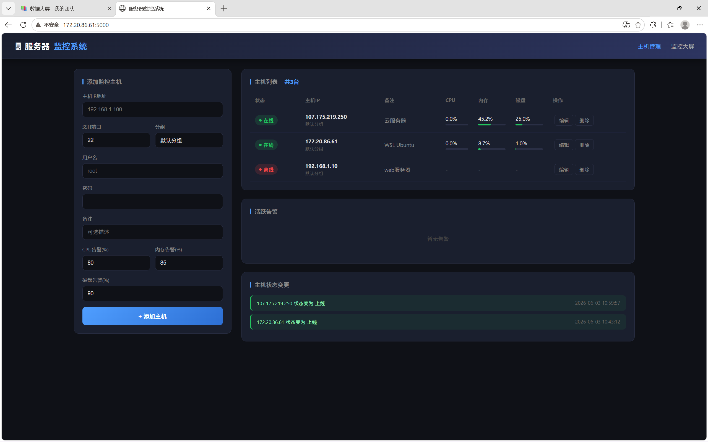
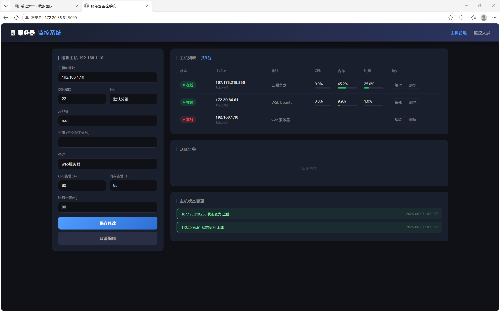

# 🖥️ 服务器实时监控系统 (mymonitor)

**一个基于 Python + Flask 的分布式多主机实时监控平台**


通过 SSH 协议无侵入地采集多台 Linux 服务器的实时运行指标，提供现代化的监控大屏、主机管理与智能告警功能。被监控主机无需安装任何 Agent，仅需开放标准 SSH 端口即可纳入监控。

-----

## 📑 目录

- [系统简介](#系统简介)
- [核心特性](#核心特性)
- [系统架构](#系统架构)
- [技术栈](#技术栈)
- [快速开始](#快速开始)
- [功能说明](#功能说明)
- [API 文档](#api-文档)
- [数据库结构](#数据库结构)
- [系统截图](#系统截图)

-----

## 系统简介

本系统是一个基于 **Python + Flask** 开发的分布式服务器监控系统，支持对多台 Linux 服务器进行实时监控和管理。系统通过 **SSH 协议远程采集**被监控主机的运行指标，采用 **SQLite** 数据库进行持久化存储，并通过现代化的深色主题 Web 界面，提供直观的监控大屏和主机管理功能。

### 设计理念

- **零侵入采集**：被监控主机无需安装任何组件，仅需开放 SSH 端口
- **跨网络监控**：既可监控本地服务器，也可监控公网云服务器
- **安全存储**：主机密码采用 Fernet 算法加密存储，杜绝明文泄露
- **现代化界面**：深色科技风格 + ECharts 可视化大屏

-----

## 核心特性

### 1. 实时监控指标

- ✅ **CPU 使用率** — 实时更新
- ✅ **内存使用率** — 总量 / 已用 / 使用率
- ✅ **磁盘使用率** — 根分区空间占用
- ✅ **网络速度** — 实时上传 / 下载速度 (MB/s)
- ✅ **系统负载** — 1 / 5 / 15 分钟平均负载
- ✅ **运行时间** — 系统启动时长

### 2. 监控大屏

- 📊 顶部概览卡片（在线主机数、平均 CPU / 内存 / 磁盘、总网速、告警数）
- 🎯 CPU / 内存 / 磁盘三个圆形仪表盘
- 📈 资源使用趋势图（CPU / 内存 / 磁盘曲线）
- 🌐 实时网速波动图
- 🔔 告警与状态信息流
- ⏰ 实时时钟，数据每 3 秒自动刷新

### 3. 主机管理

- ➕ **添加主机** — 输入 IP、端口、用户名、密码即可
- ✏️ **编辑主机** — 配置信息一键回填，支持密码留空不修改
- ❌ **删除主机** — 一键移除
- 🗂️ **主机分组** — 支持对主机进行分组管理
- ⚙️ **自定义告警阈值** — 每台主机可独立设置 CPU / 内存 / 磁盘阈值

### 4. 智能告警与状态追踪

- 🚨 CPU / 内存 / 磁盘超阈值自动告警
- 🎨 告警颜色分级（严重 / 警告）
- 📌 主机上线 / 下线状态变更自动记录
- ⏱️ 精确到秒的时间记录

### 5. 安全特性

- 🔐 主机密码使用 **Fernet 对称加密**存储，密钥独立保存
- 🛡️ API 接口主动剔除密码字段，不向前端暴露

-----

## 系统架构

```
┌─────────────────────────────────────────────┐
│             监控中心 (Flask 应用)            │
│  ┌─────────┐ ┌──────────┐ ┌──────────────┐  │
│  │ Web服务 │ │ 数据采集 │ │  定时调度    │  │
│  │  Flask  │ │Collector │ │ APScheduler  │  │
│  └─────────┘ └──────────┘ └──────────────┘  │
│  ┌─────────────────────────────────────────┐ │
│  │       SQLite 数据库 (持久化存储)        │ │
│  └─────────────────────────────────────────┘ │
└─────────────────────────────────────────────┘
                     │  SSH (端口 22)
                     ↓
   ┌───────────────────────────────────────┐
   │           被监控服务器集群             │
   │  ┌────────┐  ┌────────┐  ┌────────┐   │
   │  │ 主机 1 │  │ 主机 2 │  │ 主机 N │   │
   │  └────────┘  └────────┘  └────────┘   │
   └───────────────────────────────────────┘
```

### 工作流程

1. **主机添加** → 用户在 Web 界面录入主机信息，密码加密入库
1. **数据采集** → APScheduler 每 10 秒触发，为每台主机开启独立线程并发采集
1. **远程执行** → Paramiko 建立 SSH 连接，执行 top / free / df 等命令
1. **数据存储** → 解析采集结果，写入 SQLite metrics 表
1. **告警检测** → 指标超阈值则生成告警记录
1. **状态追踪** → 主机上线 / 下线时记录状态变更
1. **前端展示** → 浏览器每 3 秒拉取数据，刷新列表、仪表盘与图表

-----

## 技术栈

### 后端

|技术          |用途                     |
|------------|-----------------------|
|Python 3.12 |主要编程语言                 |
|Flask       |Web 框架，提供页面路由与 REST API|
|Paramiko    |基于 SSH 的远程命令执行与数据采集    |
|APScheduler |后台定时任务调度（每 10 秒）       |
|threading   |多线程并发采集多台主机            |
|cryptography|Fernet 算法加密存储主机密码      |
|SQLite 3    |嵌入式数据库，持久化存储           |

### 前端

|技术              |用途               |
|----------------|-----------------|
|HTML5 + CSS3    |页面结构与深色主题样式      |
|JavaScript (ES6)|前端交互与数据请求逻辑      |
|ECharts 5.4.3   |圆形仪表盘、资源趋势图、实时网速图|
|Fetch API       |异步调用后端接口，定时刷新    |

-----

## 快速开始

### 环境准备

```bash
# 创建项目目录并进入
mkdir -p mymonitor && cd mymonitor

# 创建并激活虚拟环境
python3 -m venv venv
source venv/bin/activate

# 安装依赖
pip install flask paramiko psutil apscheduler cryptography
```

### 启动服务

```bash
# 确保 SSH 服务已开启
service ssh start

# 启动监控系统
python3 app.py
```

启动成功后，控制台输出 `Running on http://0.0.0.0:5000`，在浏览器访问：

```
主机管理：http://<服务器IP>:5000/
监控大屏：http://<服务器IP>:5000/dashboard
```

### 添加第一台主机

1. 打开主机管理页面
1. 在左侧表单填写主机 IP、SSH 端口、用户名、密码、备注及告警阈值
1. 点击「添加主机」，系统将在 10 秒内完成首次采集

-----

## 功能说明

### 主机管理页面 (`/`)

- 主机列表：实时状态（在线 / 离线）、CPU / 内存 / 磁盘使用率
- 添加 / 编辑 / 删除主机
- 活跃告警展示
- 主机状态变更记录

### 监控大屏 (`/dashboard`)

- 1920×1080 适配的全屏大屏
- 概览卡片 + 仪表盘 + 趋势图 + 网速图 + 告警信息流
- 每 3 秒实时刷新

-----

## API 文档

|方法    |路径                   |说明         |
|------|---------------------|-----------|
|GET   |`/api/hosts`         |获取所有主机及最新指标|
|POST  |`/api/hosts`         |添加被监控主机    |
|PUT   |`/api/hosts/<id>`    |编辑修改主机配置   |
|DELETE|`/api/hosts/<id>`    |删除指定主机     |
|GET   |`/api/metrics/<id>`  |获取主机历史监控数据 |
|GET   |`/api/alerts`        |获取活跃告警列表   |
|GET   |`/api/status_changes`|获取主机状态变更记录 |
|GET   |`/api/overview`      |获取大屏概览统计数据 |

-----

## 数据库结构

系统采用 SQLite 数据库，包含四张数据表：

### hosts（主机表）

|字段                                            |类型       |说明                  |
|----------------------------------------------|---------|--------------------|
|id                                            |INTEGER  |主键，自增               |
|ip                                            |TEXT     |IP 地址（唯一）           |
|port                                          |INTEGER  |SSH 端口              |
|username                                      |TEXT     |SSH 用户名             |
|password                                      |TEXT     |加密后的密码              |
|description                                   |TEXT     |主机备注                |
|group_name                                    |TEXT     |主机分组                |
|status                                        |TEXT     |状态（online / offline）|
|cpu_threshold / mem_threshold / disk_threshold|INTEGER  |告警阈值                |
|created_at                                    |TIMESTAMP|创建时间                |

### metrics（监控数据表）

记录每次采集的 CPU、内存、磁盘、网速、负载、运行时间等指标。

### alerts（告警表）

记录超过阈值的告警类型、当前值、阈值与时间。

### status_changes（状态变更表）

记录主机上线 / 下线的状态变更历史。

-----

## 系统截图

### 主机管理页面

> 展示主机列表（在线 / 离线状态）、添加主机表单与状态变更记录


### 监控大屏

> 概览卡片、CPU / 内存 / 磁盘仪表盘、资源趋势图与实时网速图


### 编辑主机

> 主机配置一键回填，支持密码留空不修改



### 系统源代码

> 全部代码自主编写实现



-----

## 项目结构

```
mymonitor/
├── app.py              # Flask 主程序：路由、API、定时采集调度
├── collector.py        # SSH 数据采集模块
├── database.py         # 数据库初始化与密码加解密
├── templates/
│   ├── index.html      # 主机管理页面
│   └── dashboard.html  # 监控大屏
└── README.md
```

-----

## License

本项目采用 MIT 许可证。