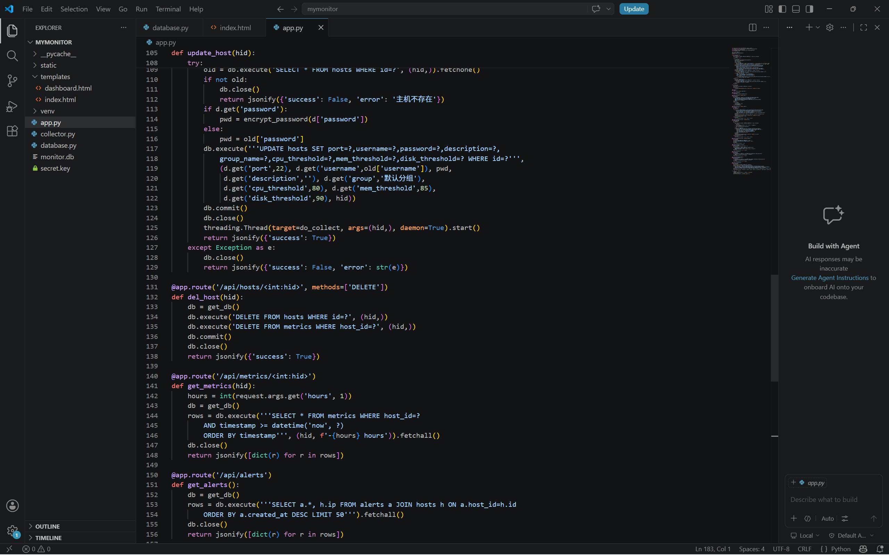
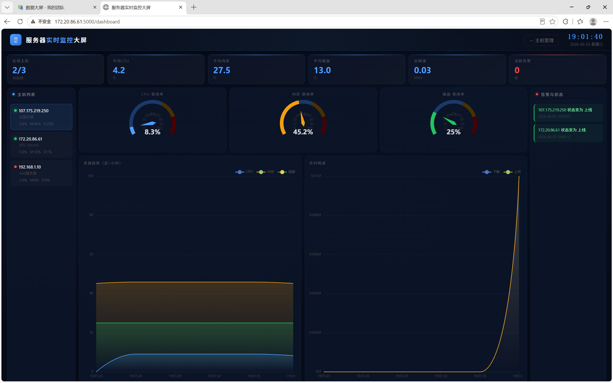

# mymonitor

通过 SSH 采集多台 Linux 服务器指标的监控系统。**不装 Agent，只开 SSH 就能接入。**



## 为什么做这个

个人有几台云服务器，想在一个页面看到所有机器的 CPU、内存、磁盘、网速和负载，不想一台台 SSH 上去敲命令。

## 技术栈

| 层 | 技术 |
|---|---|
| Web | Flask（页面 + REST API） |
| 采集 | Paramiko 走 SSH 执行 top / free / df |
| 调度 | APScheduler，每 10 秒触发一次 |
| 并发 | threading，多主机并发采集 |
| 存储 | SQLite |
| 安全 | cryptography 的 Fernet 加密主机密码 |
| 前端 | 原生 HTML + ECharts |

## 界面

| 主机管理 | 实时大屏 |
|---|---|
|  |  |

## 快速开始

```bash
pip install -r requirements.txt
python app.py
```

打开 http://127.0.0.1:5000 ，添加主机（IP / 端口 / 用户名 / 密码）即可。

## 两个设计选择

1. **不装 Agent，只开 SSH**
   被监控的主机不一定是自己的，装 Agent 要改对方环境；SSH 是现成的，开个端口就能用。

2. **3 秒轮询，不做长连接**
   监控看的是趋势，秒级实时性用不上。轮询实现简单，出问题时一眼能看出是采集端还是展示端的问题。

## 已知限制

- 只支持 Linux 主机
- 没有多用户和权限控制（单机自用）
- 告警只显示在页面上，没有推送渠道（邮件 / 企业微信还没做）

## 功能

- 多主机 CPU / 内存 / 磁盘 / 网速 / 负载采集
- 每台主机可单独配置告警阈值
- 主机上下线状态记录
- 告警流水（超阈值自动记录）

---

*个人项目，代码在持续完善中。*
